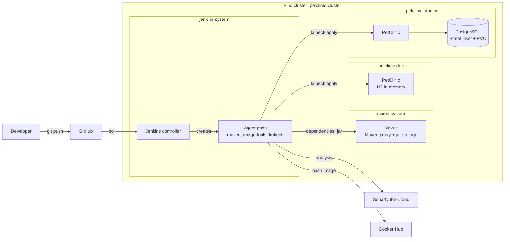
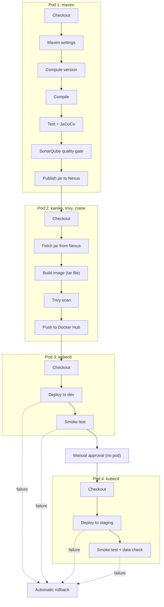

# PetClinic DevSecOps Platform on Kubernetes

**A Kubernetes-native CI/CD pipeline with Jenkins dynamic agents, a reusable shared library, quality and security gates, and automatic rollback. Everything runs on a laptop.**


> This is a portfolio and learning project. It takes the open source [Spring PetClinic](https://github.com/spring-projects/spring-petclinic) application and builds the whole delivery platform around it: cluster, CI server, artifact repository, quality gate, image scanning, deployment, and rollback. The application code is unchanged. The platform is the work.

## Contents

- [What it does](#what-it-does)
- [Architecture](#architecture)
- [The pipeline](#the-pipeline)
- [Features](#features)
- [Tech stack](#tech-stack)
- [Quick start](#quick-start)
- [Repository map](#repository-map)
- [Results](#results)
- [Design decisions](#design-decisions)
- [Lessons learned and known limits](#lessons-learned-and-known-limits)
- [Roadmap](#roadmap)
- [About the application](#about-the-application)
- [Credits and license](#credits-and-license)

## What it does

On every change to the `main` branch, Jenkins starts short-lived build pods inside a local Kubernetes cluster. The pipeline compiles and tests the code, checks code quality, stores a versioned jar in Nexus, builds a container image from that jar, scans the image, and pushes it only if the scan passes. It then deploys to a `dev` namespace and runs a smoke test. After a manual approval, the same image is deployed to `staging`, which uses a real PostgreSQL database. If a deployment or a smoke test fails, the pipeline rolls back by itself.

## Architecture



| Namespace | Contains | Managed by |
| --- | --- | --- |
| `jenkins-system` | Jenkins controller and the temporary agent pods | Applied by hand (`platform/`) |
| `nexus-system` | Nexus | Applied by hand |
| `petclinic-dev` | PetClinic with H2 | The pipeline (`k8s/dev`) |
| `petclinic-staging` | PetClinic and PostgreSQL | App by the pipeline (`k8s/staging`), database by hand |

## The pipeline



How the pieces fit:

- **The Jenkinsfile** in this repository says what runs, and in which pod. It has no long scripts.
- **The shared library** (a separate repository) holds the logic as small, reusable functions such as `buildImage`, `scanImage`, `deployToK8s`, and `rollbackK8s`.
- **Pods do not share a disk.** The jar travels through Nexus, and each pod checks out the code again and verifies that it is the same commit.
- **Images get two tags:** the first 7 characters of the commit (used by Kubernetes, and exact), and the UTC build date and time (easy to read).

## Features

- **Dynamic build agents.** Every build gets fresh pods, with only the tools it needs. The Jenkins controller runs no builds.
- **Build once, ship what you tested.** One jar per commit is stored in Nexus with the commit in its version. The image is built from that stored jar, never from a second build.
- **Security before the registry.** Kaniko builds the image to a file, Trivy scans it, and only a scan with no fixable HIGH or CRITICAL findings is pushed.
- **Quality gate.** SonarQube Cloud checks the code and reads the JaCoCo coverage. A failed gate stops the pipeline before any image exists.
- **Faster builds.** Maven downloads through a Nexus proxy, so dependencies come from inside the cluster.
- **Least privilege.** Separate service accounts: one creates agent pods, another only deploys, and only inside two namespaces. It cannot delete anything and cannot read Secrets.
- **Automatic rollback.** A failed rollout or a failed smoke test runs `kubectl rollout undo`. A failed scan never touches a running environment.
- **Environments that really differ.** Dev uses H2. Staging uses PostgreSQL with a Secret and a PVC, managed outside the application pipeline.
- **Reusable library.** The pipeline logic lives in a versioned shared library, so another app can use the same functions with its own parameters.
- **No secrets in Git.** Tokens and passwords live in Jenkins credentials and Kubernetes Secrets.

## Tech stack

| Area | Tool | Used for |
| --- | --- | --- |
| Cluster | kind | Local multi-node Kubernetes (1 control plane, 2 workers) |
| CI | Jenkins, Kubernetes plugin | Dynamic agent pods |
| Pipeline code | Declarative pipeline, Groovy shared library | Thin Jenkinsfile, reusable functions |
| Build | Maven, JUnit, JaCoCo | Compile, test, coverage |
| Quality | SonarQube Cloud (free plan) | Static analysis and quality gate |
| Artifacts | Nexus Repository | Maven proxy and jar storage |
| Images | Kaniko, crane | Build without a Docker daemon, push without a daemon |
| Security | Trivy | Vulnerability scan of the image |
| Registry | Docker Hub | Image storage |
| Deploy | kubectl, plain manifests | Dev and staging deployment, rollback |
| Database | H2 (dev), PostgreSQL (staging) | In-memory for speed, real database for staging |
| Access control | Kubernetes RBAC | Role per namespace |

## Quick start

Tested on a laptop with 14 GB of RAM. About 16 GB is more comfortable. Plan for 1 to 2 hours the first time.

### 1. Prerequisites

- Docker, `kind`, `kubectl`, and Git
- Accounts: GitHub, Docker Hub, and SonarQube Cloud (free plans are enough)
- Fork this repository and the shared library repository, and clone them

### 2. Create the cluster and the namespaces

```bash
kind create cluster --config platform/kind/kind-config.yaml

kubectl create namespace jenkins-system
kubectl create namespace nexus-system
kubectl create namespace petclinic-dev
kubectl create namespace petclinic-staging
```

### 3. Install Jenkins

```bash
kubectl apply -f platform/jenkins/jenkins.yaml
kubectl get pods -n jenkins-system -w
kubectl exec -n jenkins-system deploy/jenkins -- cat /var/jenkins_home/secrets/initialAdminPassword
```

Open `localhost:8081`, log in with that password, and install the plugins: **Kubernetes, Git, Pipeline, Credentials Binding, Coverage, Config File Provider, Timestamper**.

### 4. Apply the deploy permissions

Apply the dev file first. It creates the service account that the staging file also uses.

```bash
kubectl apply -f platform/rbac/dev-deployer.yaml
kubectl apply -f platform/rbac/staging-deployer.yaml

kubectl auth can-i patch deployments -n petclinic-dev --as=system:serviceaccount:jenkins-system:jenkins-deployer    # yes
kubectl auth can-i delete deployments -n petclinic-dev --as=system:serviceaccount:jenkins-system:jenkins-deployer   # no
```

### 5. Install Nexus

```bash
kubectl apply -f platform/nexus/nexus.yaml
kubectl port-forward svc/nexus 8082:8081 -n nexus-system
kubectl exec -n nexus-system deploy/nexus -- cat /nexus-data/admin.password
```

Open `localhost:8082` and log in as `admin`. Set a new password and enable anonymous read access. Then create a user `jenkins-ci` with rights for the hosted Maven repositories only.

### 6. Prepare the external services

- **Docker Hub:** create a repository named `petclinic` and an access token with read and write rights.
- **SonarQube Cloud:** import your fork, note the organization key and the project key, create a token, and turn **Automatic Analysis off** for the project.

### 7. Configure Jenkins

| Setting | Value |
| --- | --- |
| Built-in node, number of executors | `0` |
| Kubernetes cloud | Namespace `jenkins-system`, Jenkins URL `jenkins.jenkins-system.svc.cluster.local:8080` (with the plain `http` scheme in front), WebSocket on |
| Credential `dockerhub-creds` | Username and password (your Docker Hub user and the token) |
| Credential `sonar-cloud-token` | Secret text |
| Credential `nexus-ci` | Username and password (the `jenkins-ci` user) |
| Global environment variable `NEXUS_URL` | `nexus.nexus-system.svc.cluster.local:8081` (with the plain `http` scheme in front) |
| Managed file `maven-settings` (Config File Provider, Maven settings.xml) | The content below |
| Global Trusted Pipeline Library | Name `petclinic-shared-library`, default version `main`, Git, your library repository |

The addresses are written in Jenkins and not in files, because the application's Maven build fails on plain `http` links in any repository file.

```xml
<settings>
  <servers>
    <server>
      <id>nexus-releases</id>
      <username>${env.NEXUS_USER}</username>
      <password>${env.NEXUS_PASS}</password>
    </server>
  </servers>
  <mirrors>
    <mirror>
      <id>nexus</id>
      <mirrorOf>*</mirrorOf>
      <url>${env.NEXUS_URL}/repository/maven-public/</url>
    </mirror>
  </mirrors>
</settings>
```

### 8. Create the staging database (once)

The pipeline does not create it. Follow [`platform/staging-db/README.md`](platform/staging-db/README.md). In short:

```bash
kubectl create secret generic petclinic-db -n petclinic-staging \
  --from-literal=username=petclinic \
  --from-literal=password="$(openssl rand -base64 18 | tr -d '/+=')" \
  --from-literal=database=petclinic

kubectl apply -f platform/staging-db/postgres.yaml
kubectl get pods -n petclinic-staging -w
```

### 9. Edit the three values in the Jenkinsfile

In the `environment` block, set `IMAGE_REPO` (your Docker Hub repository), `SONAR_ORG`, and `SONAR_PROJECT`. None of them is a secret.

### 10. Create the job and run it

Create a **Pipeline** job named `petclinic-ci`: Pipeline script from SCM, Git, your fork, branch `main`, script path `Jenkinsfile`. Tick **Poll SCM** with `H/2 * * * *`. Then press **Build Now**.

Watch the pods appear and disappear:

```bash
kubectl get pods -n jenkins-system -w
```

The build stops at **Approve Staging**. Press **Deploy** to continue.

### 11. Check the result

```bash
kubectl get deploy petclinic -n petclinic-dev -o jsonpath='{.spec.template.spec.containers[0].image}'
kubectl port-forward svc/petclinic 8080:80 -n petclinic-dev
curl -s localhost:8080/actuator/health
```

The image tag must match the commit, and the health answer must show `UP`. In staging, add an owner, restart the application pod, and the owner is still there, because the data is in PostgreSQL.

### Stop and clean up

To pause for a few days, scale the stateful applications down first, so they close their files cleanly, then stop the node containers:

```bash
kubectl scale deploy/jenkins -n jenkins-system --replicas=0
kubectl scale deploy/nexus -n nexus-system --replicas=0
kubectl scale deploy/petclinic -n petclinic-dev --replicas=0
kubectl scale deploy/petclinic -n petclinic-staging --replicas=0
kubectl scale statefulset/petclinic-db -n petclinic-staging --replicas=0

docker stop petclinic-cluster-worker petclinic-cluster-worker2 petclinic-cluster-control-plane
```

To resume, start the control plane first, wait until the nodes are `Ready`, then scale everything back to 1:

```bash
docker start petclinic-cluster-control-plane
docker start petclinic-cluster-worker petclinic-cluster-worker2
kubectl get nodes
```

If `kubectl` cannot connect after a restart, run `kind export kubeconfig --name petclinic-cluster`. While the cluster is stopped, never run `docker system prune` or `docker container prune`, because they remove stopped containers, and the node containers hold all the data.

To remove everything:

```bash
kind delete cluster --name petclinic-cluster
```

This deletes all data: Jenkins jobs, Nexus content, and the staging database.

## Repository map

```
.
├── README.md
├── Jenkinsfile                 the pipeline: what runs and in which pod
├── Dockerfile                  runtime image: packages the tested jar only
├── .dockerignore
├── k8s/                        deployed by the PIPELINE
│   ├── dev/                    deployment.yaml, service.yaml
│   └── staging/                deployment.yaml, service.yaml
├── platform/                   applied BY HAND
│   ├── kind/                   cluster definition
│   ├── jenkins/                Jenkins controller
│   ├── nexus/                  Nexus
│   ├── rbac/                   deploy permissions for dev and staging
│   └── staging-db/             PostgreSQL, and the steps for its Secret
├── docs/
│   ├── upstream-README.md      the original PetClinic README
│   └── images/                 screenshots
└── src/, pom.xml, ...          the application, unchanged
```

The shared library is a separate repository: `petclinic-shared-library` (`vars/` has the functions, `resources/pods/` has the agent pod templates).

Why two folders for YAML: `k8s/` holds only what the pipeline deploys. `platform/` holds the tools and the database, which have their own owner and lifecycle and are applied by a person.

## Results

All numbers below were measured on one 14 GB laptop. Replace each `TBD` with your own value.

| Measure | Before | After |
| --- | --- | --- |
| Trivy HIGH and CRITICAL findings in the image | 11 (5 critical, 6 high) | TBD |
| Image size | TBD | TBD |
| Maven time, first run through Nexus | TBD | n/a |
| Maven time, second run through Nexus | TBD | TBD |
| Agent pods per build | 1 (single pod design) | 4 (per-job pods) |
| Memory requests held while waiting at the approval | TBD | none |
| Time from a failed deploy to the old version serving again | n/a | TBD |

The 11 findings were in Tomcat, Spring MVC, the PostgreSQL driver, and Jackson. They were fixed by upgrading Spring Boot from 4.1.0 to 4.1.1, and the scan was repeated.

Screenshots to add in `docs/images/`:

- `pipeline-green.png`: a full successful run
- `rollback.png`: a red build, with the automatic rollback
- `sonar-overview.png`: the SonarQube Cloud overview
- `nexus-repos.png`: the stored jar versions
- `trivy-before-after.png`: the scan result before and after the fix
- `rbac-can-i.png`: yes for patch, no for delete

## Design decisions

The main ones:

| Decision | Reason |
| --- | --- |
| Jenkins agents are pods, and the controller runs no builds | Clean environment every build, and a bad build cannot hurt the controller |
| Kaniko builds a file, and a separate step pushes | The image is scanned before it reaches a registry |
| Build the jar once, store it in Nexus, copy it into the image | The artifact that passed the tests is the one that ships |
| Role per namespace, a deploy account that cannot delete | Least privilege, and a blast radius of one namespace |
| Database managed by hand, outside the application pipeline | Separate owner and lifecycle |
| SonarQube Cloud instead of self-hosting | Limited laptop memory, and the pipeline step is identical |

## Lessons learned and known limits

A few problems from building it that changed how I work:

- A green image build does not prove the image works. A wrong `COPY` path built fine and the pod crashed. The failed rollout triggered the rollback, and I now test an image locally before it goes into the pipeline.
- Read the printed command and the events before guessing. A message about old replicas pending termination looked like a slow shutdown, but the new pod was crashing.
- Project rules apply to new files too. The application's Maven build fails on plain `http` links in any file.

Known limits, stated honestly:

- Dev uses H2, so its data is lost on restart and it must run one replica.
- Dev and staging share one cluster, which is not real isolation.
- The publish step builds the jar again with the commit in its version. The tests ran earlier on the same commit, but the uploaded file is a new build of it.
- The image is one layer for the jar, so every code change rebuilds that layer.
- Some image tags (Jenkins, Nexus, base images) are not pinned to exact versions.
- There is no ingress and no TLS. Access uses port-forward and service names.
- Everything runs on one machine, so there is no high availability.

## Roadmap

- [ ] A second small application that uses the shared library unchanged
- [ ] A pipeline template in the library (the whole flow in one call)
- [ ] Helm or Kustomize for the manifests, or Argo CD for GitOps
- [ ] Pin all image tags, and cache the Trivy database and Maven downloads
- [ ] The same platform in a cloud cluster, provisioned with Terraform
- [ ] Monitoring with Prometheus and Grafana

## About the application

The application is the Spring PetClinic sample from the Spring team. This repository keeps its code unchanged. The original README, with the instructions for running it locally and in an IDE, is in [`docs/upstream-README.md`](docs/upstream-README.md).

## Credits and license

- Spring PetClinic is a project of the Spring team: [spring-projects/spring-petclinic](https://github.com/spring-projects/spring-petclinic).
- The application and this repository are released under the [Apache License 2.0](LICENSE.txt).

**Suggested GitHub topics:** `jenkins` `kubernetes` `kind` `ci-cd` `devsecops` `shared-library` `kaniko` `trivy` `sonarqube` `nexus` `rbac` `rollback` `spring-boot` `platform-engineering`